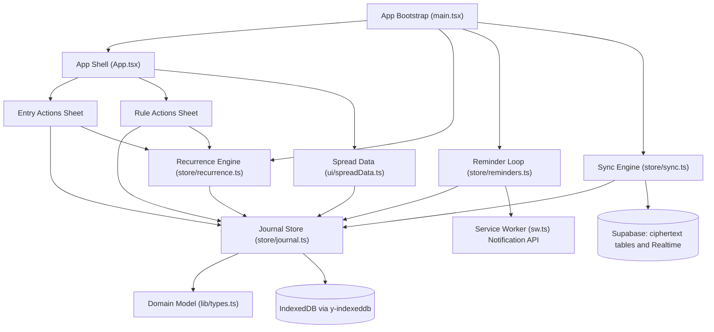
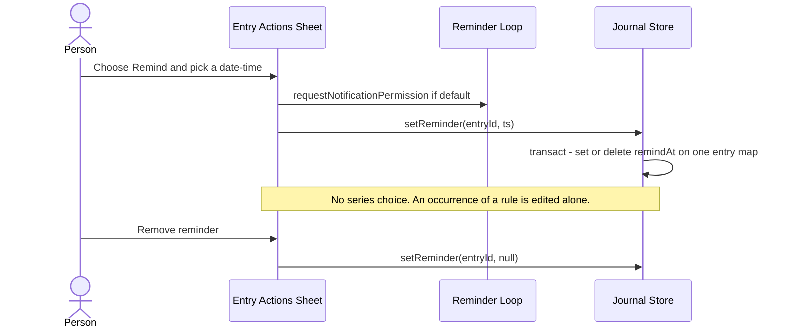
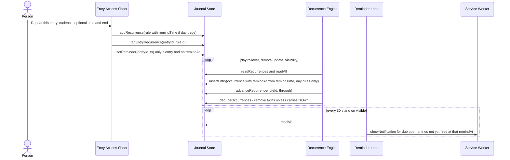
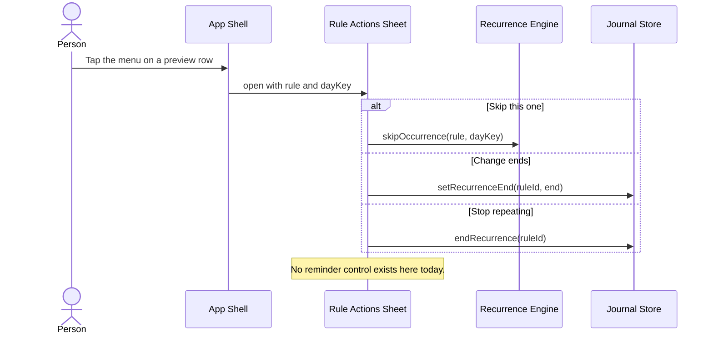
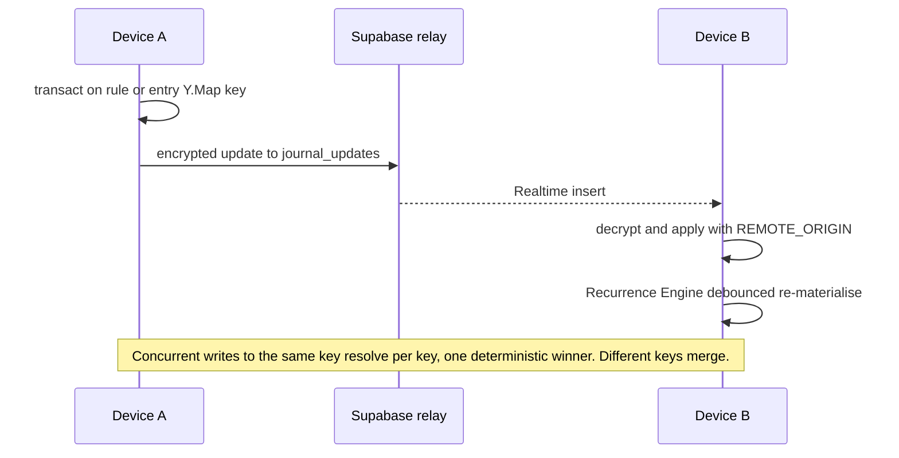

> **Confidentiality:** Internal | **Status:** DRAFT - UNREVIEWED

# Architecture — Journlet app

## System Overview

A client-only React PWA. All domain logic runs in the browser against one Yjs CRDT document persisted locally in IndexedDB. A sync engine encrypts every Yjs update with the journal's data key and relays ciphertext through Supabase (PostgREST tables plus a Realtime channel); Supabase never sees plaintext and runs no domain logic. Reminders and recurrence are entirely local loops started at boot.

## Architectural Style

**Local-first modular monolith with a CRDT data layer.** Evidence: one npm package, one bundle; layered directories (`src/lib` pure, `src/store` state and loops, `src/ui` and `src/*.tsx` presentation) with boundaries partly enforced by `tests/moduleBoundaries.test.ts`; no application server; merge semantics delegated to Yjs.

## Component Relationships

Text fallback: the bootstrap starts the App Shell, the Recurrence Engine loop, the Reminder Loop and the Sync Engine. The Entry and Rule Actions Sheets call Journal Store mutators and Recurrence Engine helpers. The Recurrence Engine, Reminder Loop, Spread Data and Sync Engine all read or write the single Yjs document owned by the Journal Store, which persists to IndexedDB. Only the Sync Engine talks to Supabase; only the Reminder Loop talks to the Notification API (through the service worker).

## Data Flow

1. A UI action calls a Journal Store mutator, which runs a `doc.transact` on a `Y.Map` inside the `entries` or `recurrences` `Y.Array`.
2. y-indexeddb persists the update locally; the Sync Engine encrypts and pushes it; other devices apply it tagged `REMOTE_ORIGIN`.
3. React re-renders from `readAll()` / `readRecurrences()` (decoded through `toEntry` / `toRecurrence`, which repair or reject malformed records).
4. Loops react: the Recurrence Engine re-materialises on day rollover, on remote updates (debounced 800 ms) and on becoming visible; the Reminder Loop checks every 30 s and on becoming visible.

## Interaction Diagrams

### 1. Set or remove a reminder from an entry (today's only path)

Text fallback: `saveReminder` parses the `datetime-local` value by hand, asks for notification permission if it has never been asked, then calls `setReminder(sheet.id, ts)`, which sets or deletes `remindAt` on that single entry. "Remove reminder" calls the same mutator with `null`. Nothing touches the rule or other occurrences.

### 2. Create a repeat with a reminder, then materialise and fire

Text fallback: `saveRepeat` creates the rule (`remindTime` only for day-scope rules), tags the source entry and gives it a reminder only if it had none. The materialiser later creates one occurrence per period up to today's period (never ahead), copying `remindTime` into `remindAt` at creation for day rules only, then dedupes twins. The Reminder Loop fires a notification for each open entry whose `remindAt` has passed and whose fired record (per rule and page for occurrences) does not already hold that `remindAt`; stale recurring occurrences from earlier days are marked seen silently.

### 3. Rule settings from a Scheduled-ahead preview row

Text fallback: the Rule Actions Sheet offers only skip, change ends and stop. There is no control and no mutator for a rule's reminder time.

### 4. Cross-device merge of a rule or entry edit

Text fallback: each device writes per-key on `Y.Map`s; updates are encrypted and relayed; the receiver applies them and the materialiser re-runs. Concurrent edits to the same key converge on one value chosen by Yjs (not by wall-clock time); edits to different keys both survive.

## Key Design Decisions (observed)

| Decision | Implication for the active intent |
|---|---|
| One Yjs document, one `Y.Map` per entry and per rule | A new rule field (for example a reminder time edit or an effective-from boundary) is a per-key write that syncs encrypted like any other; concurrent edits to the same key resolve to one winner. |
| Rule fields written once at creation, except ends (`setRecurrenceEnd`), `materialisedThrough` and `endedAt` | There is no mutator for `remindTime`; editing a series reminder needs a new one. |
| `remindTime` is copied into each occurrence's `remindAt` at materialisation, day-scope rules only | Already-materialised occurrences never see a later rule change; a series edit needs an explicit pass over existing occurrences. Week/month/year rules carry no reminder. |
| Materialise up to today's period only, never ahead | "This occurrence onward" covers at most today's occurrence among existing entries; every future one is created later from the rule. |
| Occurrence and rule-derived reminder are indistinguishable | Nothing records whether an occurrence's `remindAt` came from the rule or was set by hand; comparing with the rule-derived time is the only signal. |
| Dedupe keeps a twin whose `remindAt` differs (`carriesItsOwn`) | A series reminder change applied on one device while another materialises the same day can leave a visible duplicate. |
| Decoding repairs or rejects (`toRecurrence`) and ignores unknown keys | Older clients ignore a new rule key and keep materialising from `remindTime` alone. |
| Fired tracking per device in `localStorage`, keyed by rule and page with the fired `remindAt` | A changed time re-arms each affected occurrence once, by design. |

## Security Notes

No auth bypass found in the scanned areas. Supabase access is behind RLS on `auth.uid()`; content is end-to-end encrypted. The committed Supabase URL and publishable anon key are public by design (see `dependencies.md`). Reminders and recurrence never leave the device except as encrypted document updates.

## Improvement Opportunities

- Give rule-level edits (reminder time, effective-from boundary) explicit mutators alongside `setRecurrenceEnd`, rather than writing to rule maps ad hoc.
- Share one reminder-timestamp helper (`remindAtFor` is private; `saveRepeat` duplicates it).
- Record reminder provenance on occurrences if "keeps its own reminder" must be exact.
- Split the largest multi-responsibility files when they are next touched (see `code-quality-assessment.md`).
