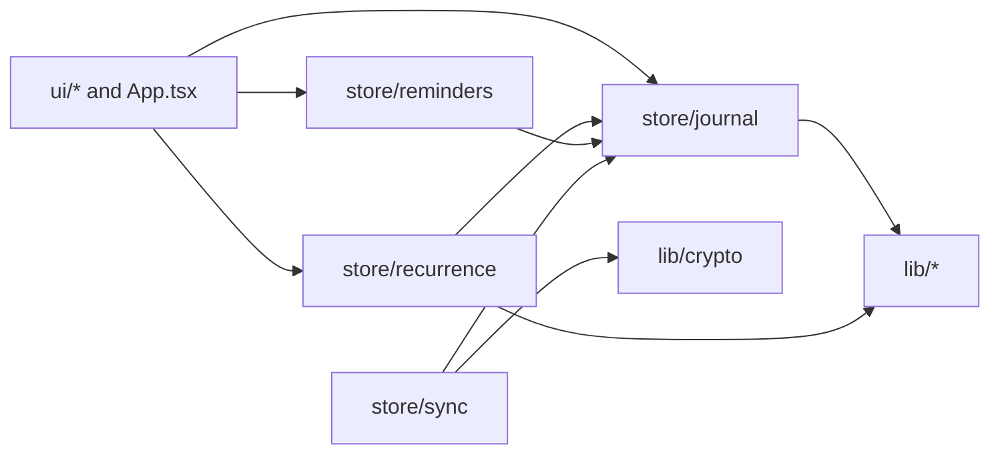

> **Confidentiality:** Internal | **Status:** DRAFT - UNREVIEWED

# Dependencies — Journlet app

Library versions are listed once in `technology-stack.md`; this file records how things depend on each other.

## External Service Dependencies

| Dependency | Direction | Failure behaviour |
|---|---|---|
| Supabase (Auth, PostgREST, Realtime) | App → Supabase, ciphertext only | App stays fully usable offline; sync resumes and reconciles by state-vector diff |
| Browser Notification API / service worker | Reminder Loop → platform | Without permission nothing fires; the Due list remains the dependable fallback. No delivery while the app is fully closed (server push deferred, spec §11 Q6) |
| IndexedDB | Journal Store → platform | Local persistence of the Yjs document |
| localStorage | Reminder Loop → platform | Per-device fired-reminder map; best-effort read and write |

**Committed client configuration**: `src/lib/supabaseConfig.ts` holds the Supabase URL and publishable anon key. This is intentional and not a secret leak: the key is public by design, every table is behind RLS on `auth.uid()`, and content is end-to-end encrypted. No service-role key or other credential is committed in the scanned areas.

## Internal Module Dependencies

Text fallback: UI modules depend on `store/journal`, `store/recurrence` and `store/reminders`; `store/recurrence` and `store/reminders` depend on `store/journal` (`readAll`, mutators); `store/sync` depends on `store/journal` (`doc`, `REMOTE_ORIGIN`) and `lib/crypto`; store modules depend on `lib/*`. `lib/*` depends on nothing in `store` or `ui`. Layer direction is partly enforced by `tests/moduleBoundaries.test.ts`.

## Coupling Through Shared State

All stateful components share the one Yjs document owned by the Journal Store. Coupling for the active intent:

- Recurrence Engine reads rules and entries and writes occurrences, so any series-reminder change interacts with materialisation and dedupe on every device.
- Reminder Loop reads `remindAt` from every entry; it is agnostic to where a reminder came from.
- Sync Engine propagates every key write; an older client that does not know a new rule key ignores it while still materialising from `remindTime`.

## Build and CI Dependencies

`npm ci --ignore-scripts` in CI; GitHub Actions pinned by SHA; Dependabot configured; one `overrides` entry replaces `@trickfilm400/rollup-plugin-off-main-thread` with the `@surma` package.
